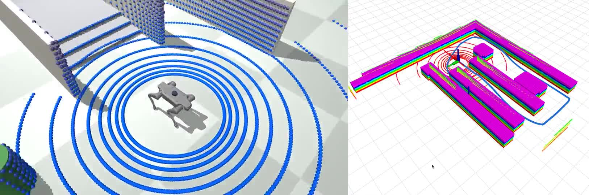

# Star Nav

Star Nav is a ROS Noetic navigation stack for **drones and legged robots**:
an EGO-Planner based local planner and a waypoint exploration manager, with
simulators to develop and test them. One planning stack drives every robot:

| | Quadrotor | Quadruped (DeepRobotics Lite3) | Humanoid (Booster T1) |
| --- | --- | --- | --- |
| Simulation | kinematic, or MuJoCo 4 with flight dynamics | MuJoCo 4, walking with DeepRobotics' own policy | MuJoCo 4, walking with Booster Robotics' own policy |
| World | random forest of pillars and rings | furnished house with a ramp and stairs (default), or the forest | the house (taller walls), or the forest |
| Obstacle sensor | forward depth camera or 360° lidar | lidar on its back (depth camera in the forest) | lidar on its head |
| Robot-specific parts | SE(3) flight controller; `px4ctrl` for PX4 | velocity tracker; terrain filter for ramps and steps | the same as the Lite3 |
| Launch | `exploration_mujoco.launch` | `exploration_lite3.launch` | `exploration_t1.launch` |
| End-to-end test | `sim_smoke.test`, `mujoco_smoke.test` (CI) | `lite3_smoke.test` (local: the robot is downloaded) | `t1_smoke.test` (local) |
| Page | [project page](https://1nrobotics.github.io/star-nav/) | [quadruped page](https://1nrobotics.github.io/star-nav/quadruped.html) | [humanoid page](https://1nrobotics.github.io/star-nav/humanoid.html) |
| Hardware | `hardware/vk180` branch ([Hardware Guide](docs/HARDWARE.md)) | simulation only so far ([status](docs/QUADRUPED.md)) | simulation only |

The `main` branch is simulation-first and hardware-independent. Integration
with specific onboard sensors lives on dedicated hardware branches.


*Quadrotor. Left: the MuJoCo simulator's follow camera. Right: RViz with the
flown path and the planner's occupancy map.*



*Quadruped. Left: Lite3 in the MuJoCo house, with its lidar returns. Right:
RViz with the planner's map (walls and furniture; the ramp and steps are
walkable) and the path walked.* Full videos and the architecture are on the
[project page](https://1nrobotics.github.io/star-nav/) (source in
[`site/`](site/)).

## Status

- Simulation is the recommended entrypoint. The quadrotor missions are
  covered by automated end-to-end tests in CI; the walking robots' by
  `lite3_smoke.test` and `t1_smoke.test`, run locally.
- The repository contains mixed licensing inherited from upstream components.
  Start with [docs/LICENSES.md](docs/LICENSES.md).

## Quick Start

### Fastest check: headless test in Docker (Linux, macOS, Windows/WSL2)

```bash
cd /path/to/star-nav
./scripts/run_smoke_test.sh
```

This builds the image, runs a full exploration mission without any GUI, and
exits non-zero if the mission fails. `./scripts/run_mujoco_smoke_test.sh` runs
the same mission on the MuJoCo simulator and also fails on any collision.

### MuJoCo simulation in the browser

```bash
./scripts/setup_mujoco_env.sh                                       # once
roslaunch star_nav_bringup exploration_mujoco.launch use_rviz:=true
```

Open http://localhost:8080 and trigger exploration as below. Add
`sensor:=lidar` to avoid obstacles with a 360° lidar instead of the depth
camera ([Obstacle Sensors](docs/SENSORS.md)). In Docker, use
`SIM=mujoco ./scripts/run_sim_exploration.sh`. See
[mujoco_sim/README.md](mujoco_sim/README.md).

### Quadruped (Lite3) in MuJoCo

```bash
./scripts/setup_mujoco_env.sh --lite3                               # once: model + policy
roslaunch star_nav_bringup exploration_lite3.launch use_rviz:=true   # house, lidar
```

Trigger exploration as below; `world:=forest` walks the pillar forest. See
[docs/QUADRUPED.md](docs/QUADRUPED.md).

### Humanoid (Booster T1) in MuJoCo

```bash
./scripts/setup_mujoco_env.sh --t1                                  # once: model + policy
roslaunch star_nav_bringup exploration_t1.launch use_rviz:=true      # house, lidar
```

The same mission and planner on a 1.2 m humanoid. See
[docs/HUMANOID.md](docs/HUMANOID.md).

### Two wheels (Mondo Robotics Beni) in MuJoCo

```bash
./scripts/setup_mujoco_env.sh --beni                                # once: model + policy
roslaunch star_nav_bringup exploration_beni.launch use_rviz:=true    # house, lidar
```

The same mission and planner on a 0.2 m robot that balances on two wheels.
See [mujoco_sim/README.md](mujoco_sim/README.md#beni-two-wheels).

### Interactive simulation with RViz (Linux host)

```bash
./docker/local-deploy.sh
```

Terminal 1:

```bash
./scripts/run_sim_exploration.sh
```

Terminal 2:

```bash
./scripts/trigger_exploration.sh
```

To customize the search area:

```bash
./scripts/run_sim_exploration.sh exploration_width:=12 exploration_height:=12 line_spacing:=4
```

Instead of the trigger script you can also press **Start Exploration** in the
RViz GCS panel.

### Native ROS Noetic workflow (Ubuntu 20.04)

The repository is the `src` folder of a catkin workspace:

```bash
git clone https://github.com/1nrobotics/star-nav.git ~/catkin_ws/src
cd ~/catkin_ws
source /opt/ros/noetic/setup.bash
rosdep install --from-paths src --ignore-src -r -y
catkin_make -DCMAKE_BUILD_TYPE=Release
source devel/setup.bash
roslaunch star_nav_bringup exploration_sim.launch use_rviz:=true
rostopic pub -1 /exploration/trigger geometry_msgs/PoseStamped "{}"
```

## Documentation

- [Simulation Guide](docs/SIMULATION.md)
- [Obstacle Sensors: depth camera or lidar](docs/SENSORS.md)
- [Quadruped (Lite3): development status](docs/QUADRUPED.md)
- [Humanoid (T1): development status](docs/HUMANOID.md)
- [Planning for ground robots: survey notes](docs/GROUND_PLANNING.md)
- [MuJoCo simulator: architecture](docs/SIM_ARCHITECTURE.md)
- [Hardware Guide](docs/HARDWARE.md)
- [Licensing Notes](docs/LICENSES.md)
- [Contributing](CONTRIBUTING.md)
- [Code of Conduct](CODE_OF_CONDUCT.md)
- [Security Policy](SECURITY.md)
- [Citing Star Nav](CITATION.cff)
- [Open-Source Branch Plan](docs/OPEN_SOURCE_PLAN.md)

## Repository Layout

- `star_nav_bringup/`: launch files, RViz config and the simulation smoke tests
- `mujoco_sim/`: standalone MuJoCo simulator for the quadrotor, the Lite3 quadruped, the T1 humanoid and Beni (Python, no ROS)
- `mujoco_bridge/`: ROS bridge between `mujoco_sim` and the planning stack
- `planner/`: EGO-Planner-based planning stack and exploration manager
- `uav_simulator/`: simulation, mapping, and local sensing components
- `px4ctrl/`: PX4 controller integration
- `rviz_gcs_plugin/`: RViz panel to trigger and monitor exploration
- `utils/`: shared ROS messages, plugins, and utilities
- `docker/`, `docker-compose.yml`: container build and development workflow
- `scripts/`: helper scripts for the Docker workflow
- `site/`: project page, published to GitHub Pages by `.github/workflows/pages.yml`

## Main Entry Points

```bash
roslaunch star_nav_bringup exploration_sim.launch use_rviz:=true     # kinematic simulation
roslaunch star_nav_bringup exploration_mujoco.launch use_rviz:=true  # MuJoCo simulation
rostest star_nav_bringup sim_smoke.test                              # end-to-end test
rostest star_nav_bringup mujoco_smoke.test                           # end-to-end test, MuJoCo
roslaunch star_nav_bringup exploration_lite3.launch use_rviz:=true   # Lite3 quadruped (setup_mujoco_env.sh --lite3)
rostest star_nav_bringup lite3_smoke.test                            # end-to-end test, Lite3 in the house
roslaunch star_nav_bringup exploration_t1.launch use_rviz:=true      # T1 humanoid (setup_mujoco_env.sh --t1)
rostest star_nav_bringup t1_smoke.test                               # end-to-end test, T1 in the house
```

## Notes for Public Users

- Some subpackage READMEs still reflect earlier internal workflows; when in
  doubt, prefer the root docs in this branch.
