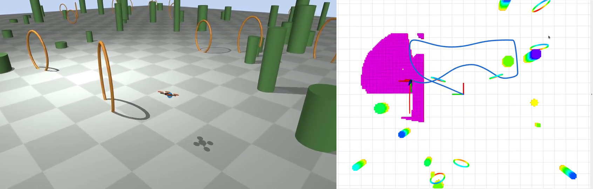

# Star Nav

Star Nav is a ROS Noetic workspace for quadrotor waypoint exploration: an
EGO-Planner based local planner, a waypoint exploration manager, two
simulators (a lightweight kinematic one and a MuJoCo 4 one with dynamics and
a browser viewer), and a PX4 controller. The same stack also drives a walking
robot in MuJoCo: DeepRobotics' Lite3 quadruped, through a house with a ramp
and stairs ([status](docs/QUADRUPED.md),
[page](https://1nrobotics.github.io/star-nav/quadruped.html)).

The `main` branch is simulation-first and hardware-independent. Integration
with specific onboard sensors lives on dedicated hardware branches (see
[Hardware Guide](docs/HARDWARE.md)).



*Left: the MuJoCo simulator's follow camera. Right: RViz with the flown path
and the planner's occupancy map.* The [project page](https://1nrobotics.github.io/star-nav/)
has the full flight video and the simulation architecture (source in
[`site/`](site/)).

## Status

- Simulation is the recommended entrypoint and is covered by an automated
  end-to-end test.
- The repository contains mixed licensing inherited from upstream components.
  Start with [docs/LICENSES.md](docs/LICENSES.md).

## Quick Start

### Fastest check: headless test in Docker (Linux, macOS, Windows/WSL2)

```bash
cd /path/to/star-nav
./scripts/run_smoke_test.sh
```

This builds the image, runs a full exploration mission without any GUI, and
exits non-zero if the mission fails. `./scripts/run_mujoco_smoke_test.sh` runs
the same mission on the MuJoCo simulator and also fails on any collision.

### MuJoCo simulation in the browser

```bash
./scripts/setup_mujoco_env.sh                                       # once
roslaunch star_nav_bringup exploration_mujoco.launch use_rviz:=true
```

Open http://localhost:8080 and trigger exploration as below. Add
`sensor:=lidar` to avoid obstacles with a 360° lidar instead of the depth
camera ([Obstacle Sensors](docs/SENSORS.md)). In Docker, use
`SIM=mujoco ./scripts/run_sim_exploration.sh`. See
[mujoco_sim/README.md](mujoco_sim/README.md).

### Interactive simulation with RViz (Linux host)

```bash
./docker/local-deploy.sh
```

Terminal 1:

```bash
./scripts/run_sim_exploration.sh
```

Terminal 2:

```bash
./scripts/trigger_exploration.sh
```

To customize the search area:

```bash
./scripts/run_sim_exploration.sh exploration_width:=12 exploration_height:=12 line_spacing:=4
```

Instead of the trigger script you can also press **Start Exploration** in the
RViz GCS panel.

### Native ROS Noetic workflow (Ubuntu 20.04)

The repository is the `src` folder of a catkin workspace:

```bash
git clone https://github.com/1nrobotics/star-nav.git ~/catkin_ws/src
cd ~/catkin_ws
source /opt/ros/noetic/setup.bash
rosdep install --from-paths src --ignore-src -r -y
catkin_make -DCMAKE_BUILD_TYPE=Release
source devel/setup.bash
roslaunch star_nav_bringup exploration_sim.launch use_rviz:=true
rostopic pub -1 /exploration/trigger geometry_msgs/PoseStamped "{}"
```

## Documentation

- [Simulation Guide](docs/SIMULATION.md)
- [Obstacle Sensors: depth camera or lidar](docs/SENSORS.md)
- [Quadruped (Lite3): development status](docs/QUADRUPED.md)
- [Hardware Guide](docs/HARDWARE.md)
- [Licensing Notes](docs/LICENSES.md)
- [Contributing](CONTRIBUTING.md)
- [Code of Conduct](CODE_OF_CONDUCT.md)
- [Security Policy](SECURITY.md)
- [Citing Star Nav](CITATION.cff)
- [Open-Source Branch Plan](docs/OPEN_SOURCE_PLAN.md)

## Repository Layout

- `star_nav_bringup/`: launch files, RViz config and the simulation smoke tests
- `mujoco_sim/`: standalone MuJoCo simulator (Python, no ROS)
- `mujoco_bridge/`: ROS bridge between `mujoco_sim` and the planning stack
- `planner/`: EGO-Planner-based planning stack and exploration manager
- `uav_simulator/`: simulation, mapping, and local sensing components
- `px4ctrl/`: PX4 controller integration
- `rviz_gcs_plugin/`: RViz panel to trigger and monitor exploration
- `utils/`: shared ROS messages, plugins, and utilities
- `docker/`, `docker-compose.yml`: container build and development workflow
- `scripts/`: helper scripts for the Docker workflow
- `site/`: project page, published to GitHub Pages by `.github/workflows/pages.yml`

## Main Entry Points

```bash
roslaunch star_nav_bringup exploration_sim.launch use_rviz:=true     # kinematic simulation
roslaunch star_nav_bringup exploration_mujoco.launch use_rviz:=true  # MuJoCo simulation
rostest star_nav_bringup sim_smoke.test                              # end-to-end test
rostest star_nav_bringup mujoco_smoke.test                           # end-to-end test, MuJoCo
roslaunch star_nav_bringup exploration_lite3.launch use_rviz:=true   # Lite3 quadruped (setup_mujoco_env.sh --lite3)
rostest star_nav_bringup lite3_smoke.test                            # end-to-end test, Lite3 in the house
```

## Notes for Public Users

- Some subpackage READMEs still reflect earlier internal workflows; when in
  doubt, prefer the root docs in this branch.
